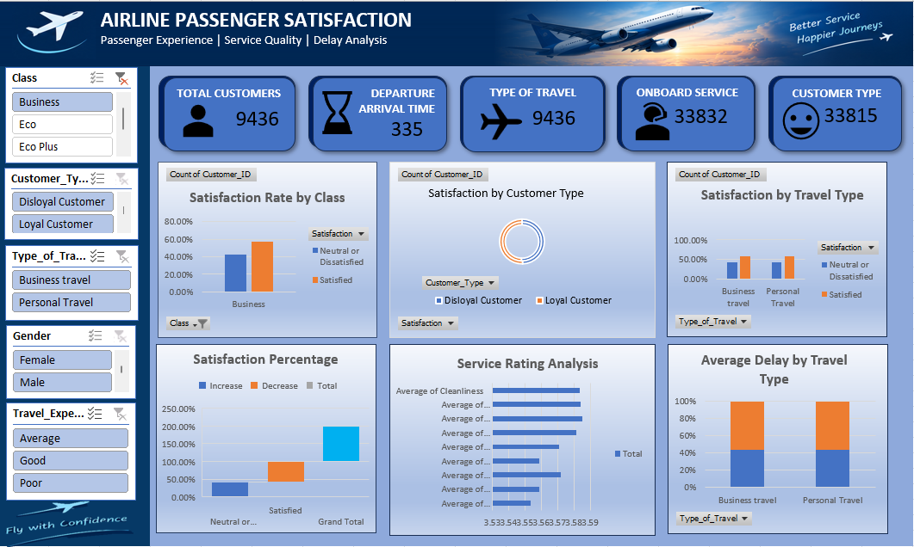

# ✈ Airline Passenger Satisfaction Analysis

## Project Overview
This project analyzes airline passenger satisfaction using Microsoft Excel. The objective is to understand passenger experience, evaluate service performance, and identify factors influencing customer satisfaction.

## Tools Used
- Microsoft Excel
- PivotTables and PivotCharts
- Excel Charts
- Slicers and Filters
- Excel Formulas

## Dataset
- 20,000 passenger records
- Passenger demographics
- Travel class and travel type
- Flight delays and distance
- Airline service ratings
- Passenger satisfaction

## Dashboard Features
- Total Passengers
- Satisfaction Rate
- Dissatisfaction Rate
- Average Flight Delays
- Satisfaction Analysis by Gender
- Satisfaction by Customer Type
- Satisfaction by Travel Class
- Service Rating Analysis

## Key Insights
- Overall passenger satisfaction rate: 59.27%.
- Business Class has the highest satisfaction rate among the travel classes.
- Loyal customers show higher satisfaction than disloyal customers.
- Cabin Service has the highest average service rating.

## Dashboard Preview

## Project Files
- passenger_project.xlsx
- cleaned_dataset.xlsx
- Airline_Dashboard.png.png
## Conclusion
This project helps identify passenger satisfaction patterns and service improvement opportunities through Excel-based data analysis and visualization.
